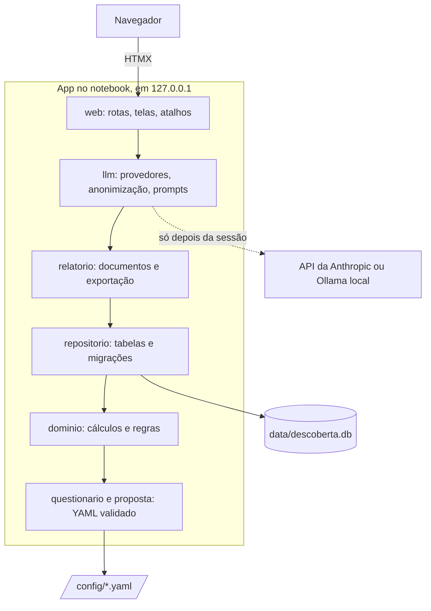

# Arquitetura e principais decisões

Esta página explica **como a app é organizada** e **por que** cada escolha foi feita. A
especificação completa do projeto está em [Especificação](../especificacao.md).

## Visão geral

Uma app web que roda **no notebook do consultor**: um servidor Python que só aceita
conexões do próprio computador (`127.0.0.1`) e o navegador como tela. Os dados ficam num
arquivo SQLite local. A internet só é usada, opcionalmente, para os rascunhos por LLM
depois da sessão.

As setas mostram quem usa quem, de fora para dentro. Uma camada pode usar as que estão mais
abaixo na pilha (o `web` usa todas), com uma exceção: o `llm` não lê o banco, e recebe os
dados já lidos. O contrário nunca acontece: o `dominio`, por exemplo, não sabe que existe
uma tela ou um banco.

## Camadas

O código fica em `src/descoberta/`, em camadas cujas **dependências apontam para dentro**:

| Camada | Responsabilidade | Não pode importar |
| --- | --- | --- |
| `questionario` | Carrega e valida o YAML do questionário; resolve as condicionais. | — |
| `proposta` | Carrega e valida o modelo da proposta; conteúdo inicial e cláusulas efetivas. | `web`, `repositorio`, `relatorio`, `llm` |
| `dominio` | Cálculos e regras puras: custo da dor, payback, scores, pendências, matriz de riscos. | `web`, `repositorio`, `llm` |
| `repositorio` | Tabelas (SQLModel), consultas e migrações. | `web`, `llm`, `relatorio` |
| `relatorio` | Monta o relatório e a proposta como documentos neutros e exporta para Markdown, DOCX e PDF. | `web`, `llm` |
| `llm` | Provedores, anonimização, prompts e geração de rascunhos. | `web`, `repositorio` |
| `web` | Rotas FastAPI, templates Jinja2, HTMX e atalhos. | — |

**Por quê:** o núcleo (as contas e as regras) fica testável sozinho, sem banco, sem tela e
sem rede. Uma mudança na tela não quebra uma conta. Essas regras não são só uma intenção:
`tests/test_estrutura.py` lê os imports de cada arquivo e falha se uma camada importar o
que não pode. O mesmo teste impede o relatório de importar os módulos de cálculo: ele
recebe os números prontos do painel.

## Decisões

### FastAPI + HTMX, sem frontend separado

**Decisão:** o servidor (FastAPI) devolve HTML pronto (Jinja2), e o HTMX troca pedaços da
página sem recarregar. Não há React nem etapa de build do frontend.

**Por quê:** o requisito mais duro é o **salvamento a cada campo** durante a conversa, sem
travar a digitação. O Streamlit, a alternativa "só Python", refaz a página inteira a cada
interação e faz isso mal. Com HTMX, o projeto fica em Python quase de ponta a ponta, e o
JavaScript se resume a dois pontos: os atalhos de teclado (`static/atalhos.js`) e o aviso
de falha de salvamento.

**Como funciona o HTMX aqui:** um campo de resposta leva atributos como
`hx-post="/sessoes/1/respostas/b1.o2"` e `hx-trigger="input changed delay:800ms, blur
changed"`. Quando você para de digitar por 0,8 s ou sai do campo, o HTMX envia o valor, e a
resposta do servidor ("Salvo às 14:32") entra só no aviso ao lado do campo, sem tirar o
cursor do lugar. Quando uma mudança afeta outra parte da tela (um número muda o painel de
cálculos), o servidor manda o cabeçalho `HX-Trigger: calculos-mudaram`, e o painel, que
escuta esse evento, se recarrega sozinho.

**Detalhes que importam:**

- `historyCacheSize: 0`: o HTMX não guarda cópias das páginas, que têm dados de clientes,
  no navegador.
- Os links das abas funcionam também sem HTMX (o `href` continua lá), e o endereço muda
  (`?bloco=4`), para o F5 reabrir na mesma aba.
- Depois de um envio que grava (registrar uma versão), a app redireciona (padrão
  POST → redirecionamento → GET), para o F5 não registrar de novo.

### SQLite, num arquivo local

**Decisão:** SQLite com SQLModel, num arquivo só (`data/descoberta.db`).

**Por quê:** um usuário, um computador, sem servidor de banco para instalar. O backup é
copiar um arquivo. Centenas de clientes cabem com folga (medição em
[Atributos de qualidade](../qualidade/evidencias.md#eficiencia)).

**Cuidados:** as chaves estrangeiras são ligadas em cada conexão (o SQLite as ignora por
padrão); dinheiro e horas são gravados como texto e lidos como `Decimal`, para não perder
precisão; os horários ficam em UTC.

### O questionário em YAML, validado e versionado

**Decisão:** o questionário (e o modelo da proposta, e os prompts) vive em arquivos fora do
código, validados com Pydantic **quando a app liga**. Cada sessão guarda a versão usada.

**Por quê:** a metodologia muda mais do que o código, e quem a mantém não precisa
programar. Validar ao ligar faz um erro de digitação aparecer antes da reunião, e não no
meio dela. Guardar a versão na sessão garante que uma sessão antiga continue sendo lida
como foi feita, mesmo depois de uma v2. Os modelos recusam campos desconhecidos
(`extra="forbid"`): `texo` no lugar de `texto` é erro, e não um campo ignorado.

### Números em campos próprios, contas só no domínio

**Decisão:** cada número da sessão tem um campo (`metricas`), e nenhuma conta tira números
do texto das respostas. As contas ficam em `dominio`, e o **painel**
(`dominio/painel.py`) é a única fonte dos números da tela **e** do relatório.

**Por quê:** extrair "15 chamados" de uma frase é frágil e não testável. Com o painel único,
o relatório nunca mostra um número diferente da tela. Os limites dos scores vêm do YAML, e
nenhum limite de faixa está escrito no código.

### Documentos como blocos neutros, exportados sem programas externos

**Decisão:** o relatório e a proposta são montados como uma lista de blocos neutros
(título, parágrafo, tabela, aviso…) e depois exportados: Markdown (próprio), DOCX
(python-docx), PDF (ReportLab, com a fonte DejaVu Sans embutida) e PDF único (pypdf).

**Por quê:** tem que funcionar **offline no Windows**, instalando só com `uv sync`.
WeasyPrint (exige GTK), pandoc, wkhtmltopdf e LibreOffice foram descartados. A fonte
embutida garante caracteres como "≥" e "→" em qualquer computador. Montar uma vez e
exportar três vezes mantém os três formatos com o mesmo conteúdo.

### Versões registradas com hash no rodapé

**Decisão:** "Registrar versão enviada" guarda o PDF como foi emitido e imprime no rodapé de
cada página o número da versão, a data e o começo do **SHA-256 do texto canônico** (o
Markdown do documento).

**Por quê:** para conferir, meses depois, se uma cópia assinada é a que foi enviada. O hash
não pode ser o do próprio PDF: imprimi-lo mudaria o arquivo. Por isso o rodapé leva o hash
do conteúdo, e o hash do PDF fica guardado à parte.

### A proposta é uma cópia, separada do relatório

**Decisão:** a proposta nasce como cópia do modelo e da revisão e depois é editada à parte,
com versões e numeração próprias. As Condições Gerais ficam congeladas com cada versão.

**Por quê:** renegociar a proposta (versão 2, 3…) não pode alterar o relatório que o
cliente já assinou, e um ajuste de cláusula depois do envio não pode mudar o que foi
enviado.

### LLM opcional, só para rascunhos

**Decisão:** o LLM só sugere textos, numa tabela própria (`rascunho`), e o consultor aceita
ou descarta. Nunca durante a sessão ao vivo, nunca para contas, condicionais ou
recomendações. Desligado por padrão. Há uma interface única de provedor
(`llm/provedor.py`), com duas implementações: API da Anthropic e Ollama local.

**Por quê:** os números e as regras precisam ser exatos e reproduzíveis, e o LLM não é
nenhuma das duas coisas. Os textos, ao contrário, ganham com um rascunho. O texto do
consultor nunca é sobrescrito sem ele aceitar. A privacidade é tratada em
[Privacidade, LGPD e anonimização](privacidade-lgpd.md).

### Migrações automáticas, com cópia antes

**Decisão:** migrações com Alembic, aplicadas **pela app ao ligar**, com cópia de segurança
antes, numa transação única e com conferência das chaves no fim.

**Por quê:** quem usa a app não roda comandos de banco. Se algo falhar, o banco volta a como
estava. Um teste de "deriva" garante que modelos e migrações dão o mesmo esquema. Bancos de
antes do Alembic são reconhecidos comparando o esquema com o da primeira migração.

### Só o próprio computador

**Decisão:** a app escuta só em `127.0.0.1`, sem opção para mudar. Aceita só os hosts
`127.0.0.1` e `localhost` e recusa pedidos que gravam vindos de outro site.

**Por quê:** a app não tem login nem HTTPS, porque foi feita para uma pessoa no próprio
notebook. Essas proteções barram os ataques possíveis a partir de outra aba do navegador.
Expor a app à rede exige muito mais: veja [Uso em produção](uso-em-producao.md).

### Instalação com o uv e dois cliques

**Decisão:** o `uv` baixa o Python certo e as bibliotecas nas versões exatas do `uv.lock`,
e o `iniciar.bat` abre a app (`uv run --no-dev --frozen`).

**Por quê:** o público não programa. Não instalar Python à mão evita a maior parte dos
problemas de instalação, e `--no-dev` deixa de fora as ferramentas de teste.

### Testes primeiro, inclusive no navegador

**Decisão:** TDD em todos os sprints; testes no navegador com Playwright; nenhum teste sai
da máquina (um fixture bloqueia conexões externas, e os provedores de LLM são falsos).

**Por quê:** é o que dá segurança para mudar. O caso de referência (Roberto) é reproduzido
em todas as camadas, do cálculo ao PDF registrado.

### Documentação ligada ao código

**Decisão:** este site (MkDocs + Material, no modelo Diátaxis) é compilado em modo estrito
no CI, e `tests/test_documentacao.py` confere as páginas de referência com o código:
atalhos, campos do YAML, tabelas do banco, variáveis de ambiente, opções de linha de
comando, faixas dos scores e caminhos citados.

**Por quê:** documentação que diverge do código é pior que nenhuma. Quando alguém cria um
atalho ou uma tabela e esquece a página, o teste avisa.
