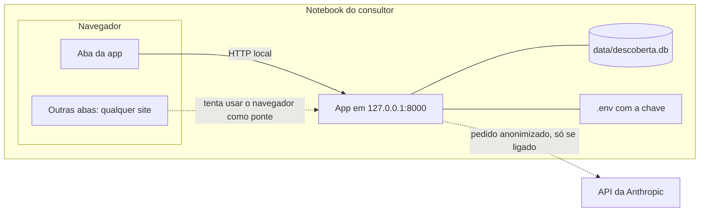

# Uso em produção e modelo de ameaças

!!! danger "A app não está pronta para a rede"
    A App de Descoberta foi feita para **uma pessoa, no próprio notebook**. Ela escuta só em
    `127.0.0.1` e **não tem login, HTTPS nem controle de acesso**. Não a exponha a outro
    computador, ao celular, a uma rede local, a um túnel (ngrok, Cloudflare Tunnel) ou a um
    servidor na nuvem sem antes aplicar **todas** as medidas da
    [lista no fim desta página](#3-medidas-necessarias-antes-de-expor-a-app). Expor a app
    hoje entrega os dados dos seus clientes a quem chegar ao endereço.

Esta página explica, em três partes, o que a app protege e o que não protege:

1. o **modelo de ameaças** do uso suportado (local);
2. o que **muda** quando a app fica acessível pela rede;
3. a **lista de medidas** necessárias antes de expor a app.

## 1. Modelo de ameaças do uso local

### O que proteger

| Ativo | Por que importa |
| --- | --- |
| Dados dos clientes (respostas, números, anotações, contatos, CPF/CNPJ) | Dados pessoais e segredos de negócio: LGPD e confiança do cliente. |
| Documentos registrados (PDFs com hash) | Valem como registro do que foi enviado e assinado. |
| Chave da API da Anthropic | Uso indevido gera custo na sua conta. |
| Seu perfil e logotipo | Aparecem em todos os documentos. |

### Fronteiras de confiança

Confia-se no **usuário do computador**: quem já entra na conta dele pode ler o banco
diretamente, e a defesa contra isso é a criptografia do disco. **Não** se confia nos
**outros sites** abertos no mesmo navegador nem na **rede**.

### Ameaças (STRIDE) e o que existe hoje

| Ameaça | Exemplo | O que existe hoje | Risco que sobra |
| --- | --- | --- | --- |
| **Falsificação** (*spoofing*) | Um site faz o próprio nome apontar para 127.0.0.1 (DNS rebinding) e lê as páginas como se fossem dele. | Só os hosts `127.0.0.1` e `localhost` são aceitos (`TrustedHostMiddleware`); outro `Host` recebe HTTP 400. | Baixo. |
| **Adulteração** (*tampering*) | Um site envia um formulário escondido para `127.0.0.1:8000` e apaga um cliente (CSRF). | Pedidos que gravam (POST, PUT, PATCH, DELETE) só passam se o navegador disser que vieram da própria app (`Sec-Fetch-Site` ou `Origin`); senão, HTTP 403 (`src/descoberta/web/protecao.py`). | Baixo, no navegador. Um pedido **sem** esses cabeçalhos (de um programa, e não de um navegador) passa: quem roda programas no computador já pode ler o banco. |
| **Adulteração** | Mudar um PDF já enviado. | Versões registradas com o SHA-256 do conteúdo no rodapé e o PDF guardado como emitido. | Baixo. O hash mostra a diferença, mas não é assinatura digital. |
| **Repúdio** | "Não foi essa versão que eu recebi." | Número de versão, data e hash em cada página; o PDF original guardado. | Médio: não há log de quem fez o quê (há um usuário só). |
| **Vazamento** (*information disclosure*) | Dados pessoais no pedido ao LLM. | Anonimização, conferência final, prévia obrigatória, anotações fora por padrão e teste do corpo do pedido HTTP (veja [Privacidade](privacidade-lgpd.md)). | Médio: um nome citado de passagem que não esteja na lista de pessoas citadas. |
| **Vazamento** | Notebook perdido ou roubado. | Fora da app: criptografia do disco e backups criptografados (README e [guia de backup](../guias/backup-e-restauracao.md)). | Alto, se o disco não estiver criptografado. A app **não** criptografa o banco. |
| **Vazamento** | Páginas com dados guardadas no navegador. | O HTMX não guarda cópias das páginas (`historyCacheSize: 0`). | Baixo: o cache e o histórico normais do navegador continuam. |
| **Vazamento** | A chave da API num log ou numa mensagem de erro. | A chave só vem do ambiente e é exibida como `**********` (`SecretStr`); o `.env` fica fora do Git, com teste; o gitleaks procura segredos no histórico. | Baixo. |
| **Negação de serviço** | Encher a app de pedidos. | Nada específico: a app só atende o próprio computador. | Fora do escopo no uso local. |
| **Elevação de privilégio** | HTML ou script num campo de texto, executado na tela (XSS). | Os templates Jinja2 escapam o texto automaticamente; o YAML é lido com `safe_load`; o logotipo é conferido pelo conteúdo e regravado. | Baixo. Ainda não há teste específico de injeção nos documentos gerados (DOCX, PDF). |
| **Cadeia de suprimentos** | Uma dependência com vulnerabilidade. | `uv.lock` com versões e hashes exatos; `pip-audit` no CI e toda semana; Dependabot; actions do CI fixadas por hash. | Baixo a médio, como em todo software. |

Os relatos de vulnerabilidade seguem o [SECURITY.md](https://github.com/Guile1984/app-descoberta/blob/main/SECURITY.md).

## 2. O que muda quando a app fica acessível pela rede

Expor a app (com `--host 0.0.0.0` no uvicorn, um redirecionamento de porta, um túnel ou um
servidor na nuvem) muda o atacante: deixa de ser "um site numa outra aba" e passa a ser
**qualquer pessoa ou robô que chegue ao endereço**.

| Hoje (local) | Exposta |
| --- | --- |
| Só o dono do computador chega à app. | Qualquer um que alcance o endereço lê, altera e apaga **tudo**: não há login. |
| O tráfego não sai do computador. | Sem HTTPS, senhas e dados passam em texto aberto pela rede (Wi-Fi do café, por exemplo). |
| A checagem de `Sec-Fetch-Site`/`Origin` barra outra aba. | Um atacante fora do navegador manda o pedido **sem** esses cabeçalhos e passa. Ela não substitui autenticação. |
| `TrustedHostMiddleware` aceita só `127.0.0.1`/`localhost`. | Um proxy reverso precisaria repassar outro `Host`, e a lista teria de mudar. A proteção contra rebinding continua útil, mas não controla **quem** acessa. |
| Um usuário, um banco. | Vários usuários pedem contas, permissões e separação dos dados de cada consultor; o SQLite não foi pensado para muitos acessos simultâneos de gravação. |
| A chave da API é do dono do notebook. | Um servidor compartilhado precisa de cofre de segredos e de controle de quem gera custo. |
| Os PDFs com hash bastam como registro. | Com várias pessoas, é preciso saber quem registrou, mudou ou apagou cada coisa. |

## 3. Medidas necessárias antes de expor a app

**Todas** são necessárias. Uma sozinha não basta: HTTPS sem login, por exemplo, só
criptografa o acesso de quem invade.

### Autenticação e controle de acesso

- Login para todas as páginas e rotas, inclusive `/static` e os downloads de PDF, com
  senhas guardadas com um hash próprio para senhas (Argon2 ou bcrypt), bloqueio depois de
  várias tentativas e, de preferência, um segundo fator (TOTP).
- Sessão com cookie `Secure`, `HttpOnly` e `SameSite`, expiração por inatividade e saída
  (logout) que invalida a sessão no servidor.
- Com mais de um consultor: cada registro ligado a um dono, e toda consulta filtrada por
  ele. Hoje, as rotas buscam a sessão pelo número na URL (`/sessoes/7`), sem conferir de
  quem é.
- Alternativa: deixar a autenticação num proxy de identidade (por exemplo, um provedor de
  login único na frente da app), sem expor a app diretamente.

### HTTPS

- TLS em todo o tráfego, com certificado válido (Let's Encrypt, por exemplo), num proxy
  reverso (Caddy, nginx) na frente do uvicorn. O uvicorn continua escutando só no
  `127.0.0.1` do servidor.
- Redirecionar HTTP para HTTPS e enviar `Strict-Transport-Security`.
- Atualizar a lista de hosts aceitos (`HOSTS_LOCAIS` em `src/descoberta/web/protecao.py`)
  para o domínio público, e só ele.

### Proteção contra CSRF completa

- Um token anti-CSRF por sessão em todo formulário e em todo pedido do HTMX (por exemplo,
  num cabeçalho enviado com `hx-headers`), conferido no servidor.
- Manter a checagem de `Sec-Fetch-Site`/`Origin` como segunda camada, mas **recusando**
  pedidos que gravam sem nenhum dos dois cabeçalhos (hoje, eles passam).
- Cookies de sessão com `SameSite=Lax` ou `Strict`.

### Limite de requisições

- Limitar pedidos por IP e por usuário, no proxy reverso ou na app: mais restrito no login,
  e com limite próprio para as rotas caras (gerar PDF, PDF único, rascunho por LLM).
- Limitar o tamanho do corpo dos pedidos no proxy. O logotipo já é recusado acima de 1 MB,
  mas só depois de recebido.

### Criptografia do banco e dos backups

- Banco criptografado em repouso: disco criptografado no servidor e, de preferência, o
  próprio banco (SQLCipher, ou a migração para um banco gerenciado com criptografia).
- Backups automáticos, criptografados, guardados **fora** do servidor, com a restauração
  **testada** periodicamente.
- Chaves de criptografia e a chave da API num cofre de segredos, nunca em arquivo no
  servidor nem no repositório.

### Logs de auditoria

- Registrar quem fez o quê e quando: login (com sucesso e com falha), criação, alteração e
  exclusão de clientes e sessões, registro de versões, downloads de documentos, pedidos
  ao LLM (sem o conteúdo) e mudanças de configuração.
- Logs protegidos contra alteração, guardados fora do servidor e **sem dados pessoais nem
  segredos** no conteúdo.
- Alertas para padrões suspeitos (muitos logins falhos, muitos downloads).

### Teste de intrusão profissional

- Antes de abrir para usuários reais, contratar um teste de intrusão (pentest) feito por
  profissionais, sobre a versão que vai para o ar, e corrigir o que for achado.
- Repetir depois de mudanças grandes e, no mínimo, uma vez por ano.

### Migrações do banco

**Já existem**, desde a versão 1.0.0: Alembic, com cópia de segurança antes, transação
única e teste de deriva (veja [Atualizar a app](../guias/atualizar-a-app.md)). Num servidor,
acrescente uma janela de manutenção e um backup externo antes de cada atualização.

### Outras medidas recomendadas

- **Cabeçalhos de segurança:** `Content-Security-Policy` (atenção: o aviso de falha de
  salvamento usa um atributo `hx-on`, que precisa ser levado em conta na política),
  `X-Content-Type-Options`, `Referrer-Policy` e `frame-ancestors` (contra clickjacking).
- **Banco para vários usuários:** PostgreSQL no lugar do SQLite, se houver gravações
  simultâneas.
- **Servidor endurecido:** sistema atualizado, firewall só com a porta 443, usuário sem
  privilégios para a app e atualizações automáticas de segurança.
- **LGPD:** contrato de operador com o provedor de nuvem, registro das operações de
  tratamento, política de retenção, um canal para pedidos dos titulares e plano de
  resposta a incidentes.
- **Monitoramento:** disponibilidade, erros e uso de disco.
- **Análise estática além do ruff** (por exemplo, CodeQL) e teste de injeção nos
  documentos gerados.

### Lista de conferência

- [ ] Autenticação em todas as rotas, com senha forte, bloqueio de tentativas e segundo fator
- [ ] Autorização por dono do registro (se houver mais de um usuário)
- [ ] HTTPS com certificado válido, HSTS e redirecionamento de HTTP
- [ ] Hosts aceitos atualizados para o domínio público
- [ ] Token anti-CSRF em todos os pedidos que gravam, e recusa sem `Origin`/`Sec-Fetch-Site`
- [ ] Limite de requisições e de tamanho de corpo
- [ ] Banco e backups criptografados, com restauração testada
- [ ] Segredos num cofre
- [ ] Logs de auditoria protegidos e sem dados pessoais
- [ ] Cabeçalhos de segurança (CSP e outros)
- [ ] Teste de intrusão profissional, com as correções feitas
- [ ] Medidas da LGPD para o novo cenário
