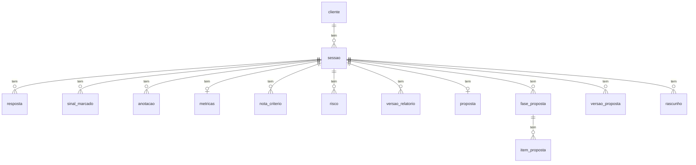

# Modelo de dados

Tudo o que você registra fica num arquivo SQLite: `data/descoberta.db` (ou o arquivo
indicado em `DESCOBERTA_BANCO`). As tabelas são definidas com SQLModel em
`src/descoberta/repositorio/modelos.py`, e a estrutura do banco evolui por migrações do
Alembic (veja [Atualizar a app](../guias/atualizar-a-app.md)).

**O que não fica no banco:** o questionário, o modelo da proposta, os prompts e a
configuração do LLM. Eles ficam nos arquivos de `config/` e `prompts/`, e o banco guarda só
os **ids** e as **versões** que vêm deles (por exemplo, `b2.o3` numa resposta, e a versão
do questionário numa sessão).

## Convenções

- **Ids do YAML como texto:** pergunta, sinal, critério, tipo de solução, categoria de
  risco e cláusula são gravados exatamente como estão no YAML. Por isso **não se renomeia
  um id** num questionário já usado.
- **Números exatos:** dinheiro e horas ficam numa coluna de texto (`"0.10"`) e voltam como
  decimal exato. O SQLite não tem tipo decimal, e a coluna numérica dele perderia precisão
  (R$ 0,10 poderia voltar como 0,1000000000000000055). As contas são feitas em Python, e
  não em SQL, então guardar como texto não atrapalha nada.
- **Horários em UTC**, com fuso. A tela converte para a hora local na hora de mostrar.
- **Exclusão em cascata:** quase tudo pertence a uma sessão (`sessao_id`), e excluir a
  sessão apaga junto tudo o que é dela. Excluir um cliente apaga as sessões dele. As chaves
  estrangeiras são ligadas em cada conexão (`PRAGMA foreign_keys=ON`), porque o SQLite as
  ignora por padrão.
- **Uma linha por sessão** em `metricas`, `cronometro`, `proposta` e `previa_llm`: a
  chave é o próprio `sessao_id`.
- Além das tabelas abaixo, o banco tem a tabela `alembic_version`, do Alembic, com a
  revisão atual do esquema.

## Cadastro e sessão

### `cliente`

| Coluna | Tipo | O que é |
| --- | --- | --- |
| `id` | inteiro | Chave. |
| `nome` | texto | Nome do contato principal (obrigatório). |
| `empresa` | texto | Empresa (obrigatório). |
| `setor` | texto, opcional | Setor. |
| `num_funcionarios` | inteiro, opcional | Número de funcionários. |
| `contato` | texto, opcional | Telefone ou e-mail. |
| `criado_em` | data e hora | Quando foi cadastrado. |

### `sessao`

| Coluna | Tipo | O que é |
| --- | --- | --- |
| `id` | inteiro | Chave. |
| `cliente_id` | inteiro | O cliente (exclusão em cascata). |
| `data` | data | Data da sessão. |
| `versao_questionario` | inteiro | Versão do questionário com que a sessão foi aberta (a mais recente na época). |
| `tipo_solucao` | texto, opcional | Id do tipo de solução escolhido no bloco 3; define as perguntas condicionais. |
| `status` | `preparacao`, `em_andamento` ou `concluida` | Status mostrado no topo da sessão. |
| `contexto_previo` | texto, opcional | Contexto registrado antes da sessão. |
| `amostra_dados_recebida` | sim/não | Se a amostra de dados chegou. |
| `criado_em` | data e hora | Quando foi aberta. |

### `resposta`

Uma por pergunta (ou item do encerramento) em cada sessão.

| Coluna | Tipo | O que é |
| --- | --- | --- |
| `id` | inteiro | Chave. |
| `sessao_id` | inteiro | A sessão. |
| `pergunta_id` | texto | Id da pergunta (`b1.o2`) ou do item do encerramento (`enc.resumo`). |
| `texto` | texto | A resposta. |
| `atualizado_em` | data e hora | Último salvamento. |

### `sinal_marcado`

Um por sinal marcado. Desmarcar apaga a linha.

| Coluna | Tipo | O que é |
| --- | --- | --- |
| `id` | inteiro | Chave. |
| `sessao_id` | inteiro | A sessão. |
| `sinal_id` | texto | Id do sinal no YAML (`b1.s4`). |
| `observacao` | texto, opcional | Observação escrita ao lado do sinal. |
| `marcado_em` | data e hora | Quando foi marcado. |

### `anotacao`

| Coluna | Tipo | O que é |
| --- | --- | --- |
| `id` | inteiro | Chave. |
| `sessao_id` | inteiro | A sessão. |
| `bloco` | inteiro, opcional | Bloco da aba aberta quando a anotação foi feita; vazio no encerramento (anotação geral). |
| `texto` | texto | A anotação. |
| `criado_em` | data e hora | Horário mostrado na lista. |

### `metricas`

Os números da sessão, cada um no seu campo, **nunca extraídos do texto das respostas**.
Todos são opcionais, porque vão sendo preenchidos ao longo da conversa. As fórmulas estão em
[Fórmulas, scores e faixas](formulas-e-scores.md).

| Coluna | Tipo | O que é |
| --- | --- | --- |
| `sessao_id` | inteiro | A sessão (é a chave). |
| `horas_por_ocorrencia` | decimal | Bloco 1. |
| `frequencia_quantidade` | decimal | Bloco 1. |
| `frequencia_periodo` | `dia`, `semana` ou `mes` | Bloco 1. |
| `custo_hora` | decimal (R$) | Bloco 1. |
| `chamadas_por_dia` | decimal | Bloco 6. |
| `custo_por_chamada` | decimal (R$) | Bloco 6. |
| `custo_fixo_mes` | decimal (R$) | Bloco 6. |
| `horas_economizadas_mes` | decimal | Bloco 9. |
| `outros_ganhos_mes` | decimal (R$) | Bloco 9. |
| `investimento` | decimal (R$) | Bloco 9. |

### `nota_criterio`

Uma nota de 0 a 3 por critério de score. Os ids de critério são únicos no questionário,
por isso a mesma tabela guarda as notas dos dois scores. A nota do critério que vem do
score de dados não é gravada aqui: ela é calculada.

| Coluna | Tipo | O que é |
| --- | --- | --- |
| `id` | inteiro | Chave. |
| `sessao_id` | inteiro | A sessão. |
| `criterio_id` | texto | Id do critério (`volume`, `dor_clara`…). |
| `nota` | inteiro | 0 a 3. |

### `cronometro`

| Coluna | Tipo | O que é |
| --- | --- | --- |
| `sessao_id` | inteiro | A sessão (é a chave). |
| `acumulado_segundos` | inteiro | Soma dos trechos já pausados. |
| `rodando_desde` | data e hora, opcional | Início do trecho atual; vazio quando pausado ou nunca iniciado. |

## Revisão pós-sessão

### `risco`

| Coluna | Tipo | O que é |
| --- | --- | --- |
| `id` | inteiro | Chave. |
| `sessao_id` | inteiro | A sessão. |
| `descricao` | texto | O risco. |
| `categoria` | texto | Id de `revisao.categorias_risco` do YAML. |
| `probabilidade` | `baixo`, `medio` ou `alto` | Eixo horizontal da matriz. |
| `impacto` | `baixo`, `medio` ou `alto` | Eixo vertical da matriz. |
| `mitigacao` | texto, opcional | Obrigatória, na prática, para riscos altos nos dois eixos (vira pendência). |
| `criado_em` | data e hora | A ordem de criação dá a numeração R1, R2… |

### `indicador`

Valor atual, meta e prazo são **texto** ("Recall ≥ 95%", "3 dias", "fim do piloto"):
misturam unidades e não entram em nenhum cálculo.

| Coluna | Tipo | O que é |
| --- | --- | --- |
| `id` | inteiro | Chave. |
| `sessao_id` | inteiro | A sessão. |
| `nome` | texto | O indicador. |
| `camada` | `negocio` ou `tecnica` | Na proposta, os técnicos entram no aceite e os de negócio nas metas. |
| `valor_atual` | texto, opcional | Como está hoje. |
| `meta` | texto, opcional | Aonde se quer chegar. |
| `prazo` | texto, opcional | Até quando. |
| `como_medir` | texto, opcional | Como medir. |
| `criado_em` | data e hora | Ordem na lista. |

### `item_escopo`

| Coluna | Tipo | O que é |
| --- | --- | --- |
| `id` | inteiro | Chave. |
| `sessao_id` | inteiro | A sessão. |
| `texto` | texto | O item. |
| `entra` | sim/não | Entra no MVP ou fica de fora. |
| `criado_em` | data e hora | Ordem na lista. |

### `proximo_passo`

| Coluna | Tipo | O que é |
| --- | --- | --- |
| `id` | inteiro | Chave. |
| `sessao_id` | inteiro | A sessão. |
| `acao` | texto | O que fazer. |
| `responsavel` | `cliente` ou `consultor` | Quem faz. Os do cliente viram responsabilidades na proposta. |
| `prazo` | data, opcional | Sem prazo, vira pendência da revisão. |
| `criado_em` | data e hora | Ordem na lista. |

### `texto_secao`

Os textos narrativos do relatório escritos na revisão.

| Coluna | Tipo | O que é |
| --- | --- | --- |
| `id` | inteiro | Chave. |
| `sessao_id` | inteiro | A sessão. |
| `secao_id` | texto | Id de `revisao.textos` do YAML (`resumo_executivo`…). |
| `texto` | texto | O texto. |
| `atualizado_em` | data e hora | Último salvamento. |

### `hipotese_metrica`

Números que o consultor assumiu, sem o cliente ter dito. O relatório os marca com `*` e os
destaca na memória de cálculo (Anexo B), e a proposta os lista nas premissas.

| Coluna | Tipo | O que é |
| --- | --- | --- |
| `id` | inteiro | Chave. |
| `sessao_id` | inteiro | A sessão. |
| `campo` | texto | Nome da coluna de `metricas` (ex.: `custo_hora`). |

## Relatório

### `versao_relatorio`

O PDF registrado como enviado, guardado **exatamente** como foi emitido. Baixar uma versão
registrada devolve esse PDF byte a byte, mesmo que os dados da sessão mudem depois.

| Coluna | Tipo | O que é |
| --- | --- | --- |
| `id` | inteiro | Chave. |
| `sessao_id` | inteiro | A sessão. |
| `numero` | inteiro | 1, 2, 3… numa só sequência por sessão, para as versões cliente e interna juntas. |
| `tipo` | `cliente` ou `interna` | A versão interna inclui o Anexo C (sinais e anotações). |
| `emitido_em` | data e hora | Data e hora impressas no rodapé. |
| `conteudo_md` | texto | O texto canônico do relatório, em Markdown. |
| `hash_conteudo` | texto | SHA-256 do `conteudo_md`. Os 12 primeiros caracteres vão no rodapé de cada página. |
| `pdf` | binário | O arquivo PDF. |
| `hash_pdf` | texto | SHA-256 do arquivo PDF. |

Por que dois hashes: um arquivo não pode conter o próprio hash (imprimi-lo mudaria o
arquivo). Por isso o rodapé leva o hash do conteúdo, e o hash do PDF serve para conferir o
arquivo inteiro.

### `relatorio`

Tabela do Sprint 3 para guardar relatórios gerados (origem `template` ou `llm`, com o
modelo e a versão do prompt). **A app de hoje não grava nela:** as versões enviadas ficam
em `versao_relatorio`, e as sugestões do LLM em `rascunho`. Ela continua no esquema para
não quebrar bancos existentes.

| Coluna | Tipo | O que é |
| --- | --- | --- |
| `id` | inteiro | Chave. |
| `sessao_id` | inteiro | A sessão. |
| `origem` | `template` ou `llm` | De onde veio o texto. |
| `conteudo` | texto | O relatório. |
| `modelo` | texto, opcional | Modelo de LLM (obrigatório quando `origem` = `llm`). |
| `versao_prompt` | texto, opcional | Versão do prompt (idem). |
| `criado_em` | data e hora | Quando foi gerado. |

## Perfil e Proposta Comercial

### `perfil_consultor`

Uma linha só (`id` = 1). Fica só no banco local e, antes de qualquer pedido ao LLM, entra
na anonimização como os dados do cliente.

| Coluna | Tipo | O que é |
| --- | --- | --- |
| `id` | inteiro | Sempre 1. |
| `nome` | texto | Nome (obrigatório). |
| `empresa` | texto | Empresa (obrigatório). |
| `cpf_cnpj` | texto, opcional | Conferido pelos dígitos verificadores e gravado formatado. |
| `email` | texto, opcional | E-mail. |
| `telefone` | texto, opcional | Telefone. |
| `cidade` | texto, opcional | Cidade (vira o `{foro}` das Condições Gerais, com a UF). |
| `uf` | texto, opcional | Sigla da UF. |
| `logotipo` | binário, opcional | PNG regravado sem metadados (como a localização de uma foto de celular). |
| `dados_ficticios` | sim/não | Ligado no banco de demonstração: os documentos avisam que o consultor é fictício. |
| `atualizado_em` | data e hora | Último salvamento. |

### `proposta`

Uma por sessão. Criada como **cópia** do modelo e da revisão, e editada à parte: mudar a
revisão depois não altera a proposta, e renegociar a proposta nunca altera o relatório.

| Coluna | Tipo | O que é |
| --- | --- | --- |
| `sessao_id` | inteiro | A sessão (é a chave). |
| `versao_modelo` | inteiro | Versão de `config/proposta_v{n}.yaml` usada na criação. |
| `cliente_cpf_cnpj` | texto, opcional | CPF ou CNPJ do cliente, conferido pelos dígitos. |
| `cliente_representante` | texto, opcional | Quem assina pelo cliente. |
| `cliente_cargo` | texto, opcional | Cargo de quem assina. |
| `cliente_email` | texto, opcional | E-mail. |
| `cliente_cidade` | texto, opcional | Cidade. |
| `cliente_uf` | texto, opcional | Sigla da UF. |
| `condicoes_pagamento` | texto | Condições de pagamento. |
| `impostos` | texto | Impostos. |
| `reajuste` | texto | Reajuste. |
| `validade_dias` | inteiro | Validade da proposta. |
| `criada_com_alerta` | sim/não | Criada depois do aviso de que o score final indicava "não seguir agora". |
| `criado_em` | data e hora | Quando foi criada. |

### `fase_proposta`

| Coluna | Tipo | O que é |
| --- | --- | --- |
| `id` | inteiro | Chave. |
| `sessao_id` | inteiro | A sessão. |
| `nome` | texto | Nome da fase. |
| `objetivo` | texto, opcional | Objetivo (o LLM pode sugerir um rascunho). |
| `duracao_semanas` | inteiro, opcional | Duração. |
| `investimento` | decimal (R$), opcional | Valor da fase. |
| `criado_em` | data e hora | Ordem das fases. |

### `item_proposta`

Os itens de lista da proposta, todos numa tabela; o `tipo` separa as listas.

| Coluna | Tipo | O que é |
| --- | --- | --- |
| `id` | inteiro | Chave. |
| `sessao_id` | inteiro | A sessão. |
| `tipo` | `escopo`, `entregavel`, `exclusao`, `premissa` ou `responsabilidade` | A lista do item. |
| `fase_id` | inteiro, opcional | A fase (só escopo e entregáveis). Excluir a fase exclui junto o escopo e os entregáveis dela. |
| `texto` | texto | O item. |
| `criado_em` | data e hora | Ordem na lista. |

### `clausula_proposta`

O ajuste de uma cláusula das Condições Gerais **nesta** proposta. O modelo não muda.

| Coluna | Tipo | O que é |
| --- | --- | --- |
| `id` | inteiro | Chave. |
| `sessao_id` | inteiro | A sessão. |
| `clausula_id` | texto | Id da cláusula no modelo. |
| `texto` | texto, opcional | Texto ajustado; vazio: vale o do modelo. |
| `excluida` | sim/não | Excluída desta proposta (só para cláusulas removíveis). |
| `atualizado_em` | data e hora | Último ajuste. |

### `versao_proposta`

Como `versao_relatorio`, com numeração própria: renegociar a proposta (versões 2, 3…) não
mexe nas versões do relatório.

| Coluna | Tipo | O que é |
| --- | --- | --- |
| `id` | inteiro | Chave. |
| `sessao_id` | inteiro | A sessão. |
| `numero` | inteiro | 1, 2, 3… |
| `emitido_em` | data e hora | Data e hora impressas no rodapé. |
| `conteudo_md` | texto | Texto canônico da proposta. |
| `hash_conteudo` | texto | SHA-256 do conteúdo (início no rodapé). |
| `pdf` | binário | O arquivo PDF. |
| `hash_pdf` | texto | SHA-256 do PDF. |
| `versao_modelo` | inteiro | Versão do modelo usada. |
| `clausulas` | JSON | As Condições Gerais **congeladas**: o texto impresso de cada cláusula (`id`, `titulo`, `texto`), como estava na emissão. |

### `texto_proposta`

| Coluna | Tipo | O que é |
| --- | --- | --- |
| `id` | inteiro | Chave. |
| `sessao_id` | inteiro | A sessão. |
| `campo` | texto | Hoje, só `contexto`. |
| `texto` | texto | O texto. |
| `atualizado_em` | data e hora | Último salvamento. |

## Rascunhos por LLM

### `rascunho`

Cada sugestão do LLM fica aqui, à parte, e **só substitui o texto do consultor se ele
aceitar**.

| Coluna | Tipo | O que é |
| --- | --- | --- |
| `id` | inteiro | Chave. |
| `sessao_id` | inteiro | A sessão. |
| `destino` | `revisao` ou `proposta` | Onde o texto vai. |
| `campo` | texto | Na revisão, o id do texto; na proposta, `contexto` ou `objetivo_fase.<id da fase>`. |
| `texto` | texto | O rascunho, já com os dados reais de volta (a anonimização é desfeita no computador). |
| `provedor` | texto | `claude` ou `ollama`. |
| `modelo` | texto | O modelo que de fato respondeu. |
| `versao_prompt` | texto | Ex.: `rascunho_revisao_v2`. |
| `alertas` | texto, opcional | Um por linha: marcador inventado, resposta cortada, tamanho fora do pedido. |
| `com_anotacoes_internas` | sim/não | Se o pedido levou as anotações e os sinais. |
| `situacao` | `pendente`, `aceito`, `descartado` ou `substituido` | `substituido`: um rascunho mais novo do mesmo campo chegou antes da decisão. |
| `criado_em` | data e hora | Quando chegou. |
| `decidido_em` | data e hora, opcional | Quando foi aceito ou descartado. |

### `pessoa_citada`

Nomes citados na sessão (fora os já conhecidos, como o do cliente) que a anonimização deve
trocar por marcadores.

| Coluna | Tipo | O que é |
| --- | --- | --- |
| `id` | inteiro | Chave. |
| `sessao_id` | inteiro | A sessão. |
| `nome` | texto | O nome. |
| `criado_em` | data e hora | Quando foi incluído. |

### `previa_llm`

Registra que o consultor viu e confirmou a prévia do que sai para o LLM.

| Coluna | Tipo | O que é |
| --- | --- | --- |
| `sessao_id` | inteiro | A sessão (é a chave). |
| `impressao` | texto | SHA-256 dos dados conhecidos (cliente, consultor, pessoas citadas…) na hora da confirmação. Se algum deles mudar, a prévia precisa ser vista de novo. |
| `confirmada_em` | data e hora | Quando foi confirmada. |
