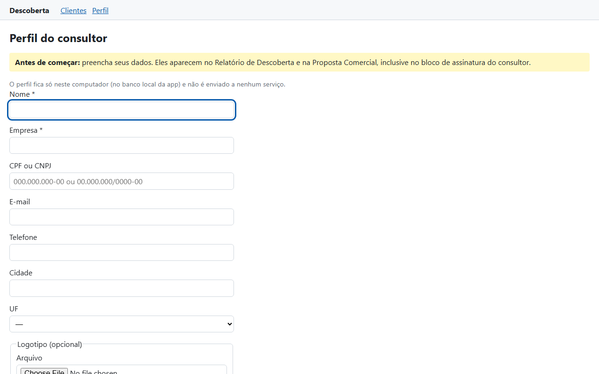
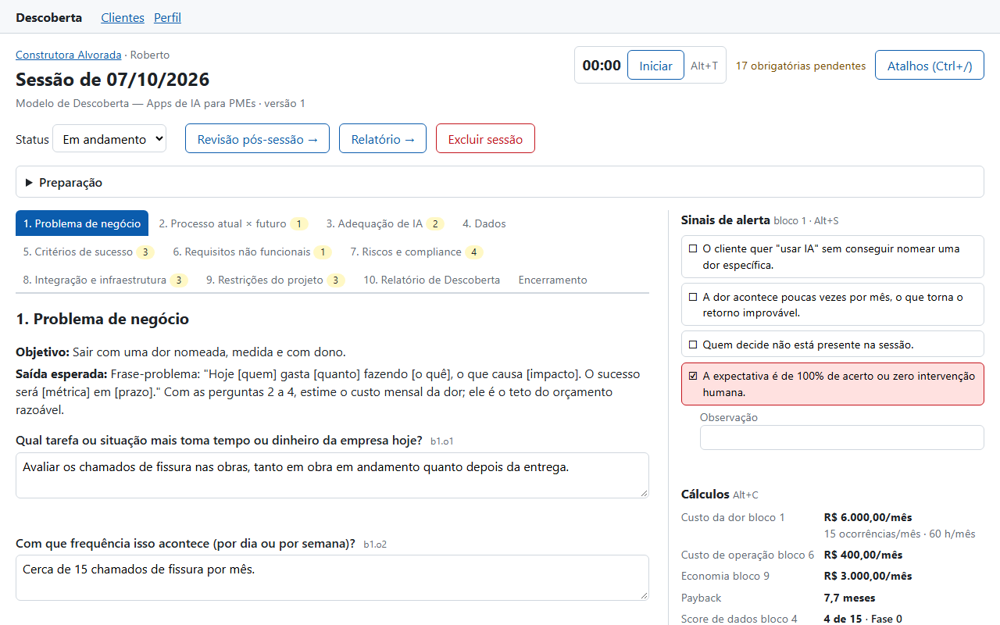
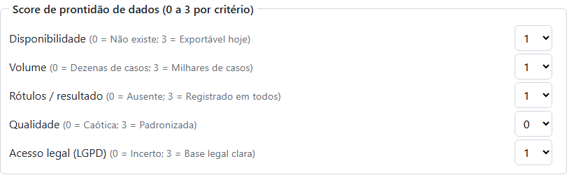
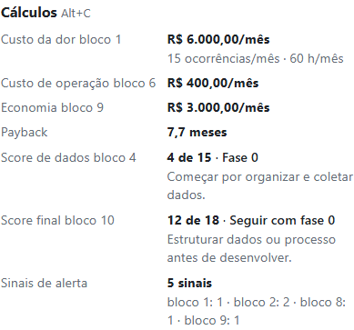
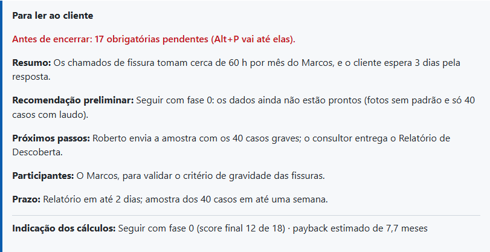
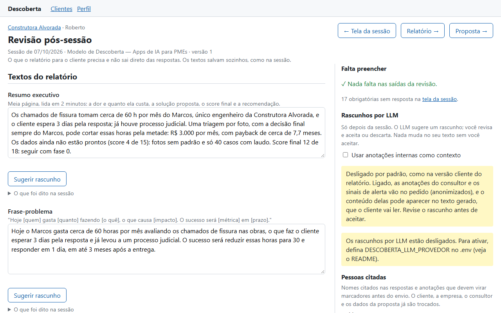
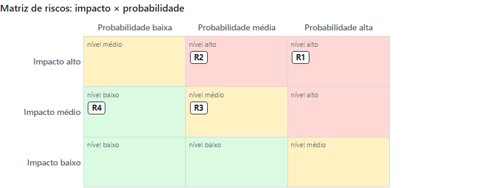
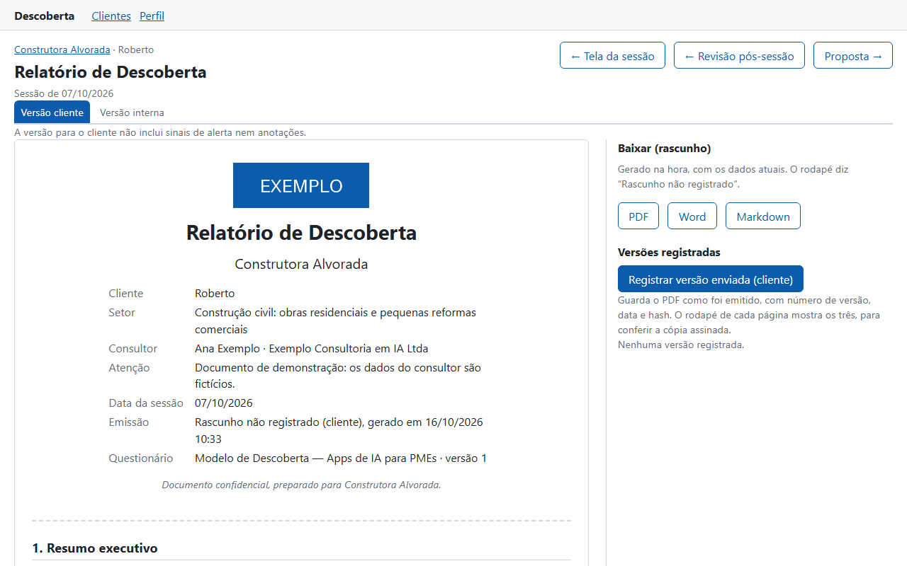
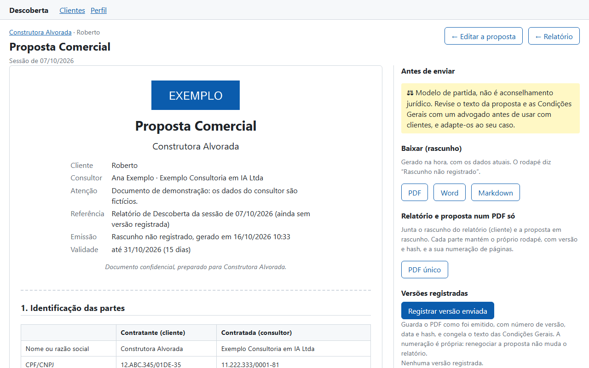

# Sua primeira sessão

Neste tutorial, você conduz do zero uma sessão de descoberta completa, a do caso de
referência: **Roberto, da Construtora Alvorada**, que perde 60 horas por mês avaliando
chamados de fissura nas obras. No fim, você terá o **Relatório de Descoberta** e a
**Proposta Comercial** registrados, com os mesmos números do banco de demonstração.

Leva cerca de 40 minutos. Você não precisa saber programar nem ter internet (só para
instalar a app).

!!! info "Antes de começar"
    Instale a app seguindo o [README](https://github.com/Guile1984/app-descoberta#instalação-no-windows-passo-a-passo):
    o `uv` e a pasta da app. Não é preciso mais nada.

## 1. Abra a app num banco de treino

Para não misturar o treino com os seus dados reais, use um banco à parte. Na pasta da app,
clique com o botão direito num espaço vazio → **Abrir no Terminal** e rode:

```powershell
$env:DESCOBERTA_BANCO = "data/tutorial.db"
uv run --no-dev python -m descoberta
```

O navegador abre em `http://127.0.0.1:8000`. Deixe a janela do terminal aberta: ela é a
app. Ao terminar o tutorial, feche-a, e os seus dados reais voltam a ser usados.

## 2. Preencha o perfil do consultor

Como o banco está vazio, a app pede primeiro o **perfil do consultor**. Ele aparece em
todos os documentos, inclusive no bloco de assinatura.



Para o treino, use dados fictícios:

| Campo | Valor |
| --- | --- |
| Nome | Ana Exemplo |
| Empresa | Exemplo Consultoria em IA Ltda |
| CPF ou CNPJ | 11.222.333/0001-81 (um CNPJ de teste: os dígitos conferem) |
| Cidade / UF | São Paulo / SP |

Clique em **Salvar**. O logotipo é opcional.

## 3. Cadastre o cliente e abra a sessão

1. Em **Clientes**, clique em **Novo cliente**.
2. Preencha **Nome do contato**: `Roberto`; **Empresa**: `Construtora Alvorada`;
   **Setor**: `Construção civil`; **Nº de funcionários**: `35`. Clique em **Salvar**.
3. Na página do cliente, deixe a data de hoje e clique em **Abrir nova sessão**.

Você está na **tela da sessão**: as perguntas à esquerda; sinais de alerta, cálculos e
anotações à direita.



Tecle `Ctrl+/` para ver os atalhos de teclado (e `Esc` para fechar). Neste tutorial,
usamos o mouse e os atalhos.

## 4. Conduza os blocos

**Inicie o cronômetro** com `Alt+T`. Ele mostra o tempo da sessão e muda de cor perto do
limite.

### Bloco 1: o problema

Responda as primeiras perguntas obrigatórias. Cada campo **salva sozinho** quando você para
de digitar ou sai dele: aparece "Salvo às…".

- *Qual tarefa ou situação mais toma tempo ou dinheiro da empresa hoje?*
  `Avaliar os chamados de fissura nas obras.`
- *Com que frequência isso acontece?* `Cerca de 15 chamados por mês.`
- *Quantas pessoas se envolvem e quanto tempo cada uma gasta?*
  `Só o Marcos, o engenheiro: meio dia (4 h) por chamado.`

Abaixo das perguntas, na caixa **Números do bloco**, digite os números nos campos próprios.
A app nunca tira números do texto das respostas:

| Campo | Valor |
| --- | --- |
| Horas por ocorrência | `4` |
| Ocorrências | `15` |
| Período da frequência | por mês |
| Custo da hora | `100` |

Olhe o painel **Cálculos**, à direita: **R$ 6.000,00/mês** de custo da dor, com 15
ocorrências e **60 h/mês**.

!!! tip "Vírgula para decimais"
    Digite `7,5` (e não `7.5`) e `20.000` para milhar. A app recusa `7.5` para não ler
    errado.

### Bloco 3: o tipo de solução

Tecle `Alt+3`. Em **Tipo de solução**, escolha **Visão computacional**: o Roberto quer
triar fotos das fissuras. Isso abre perguntas **condicionais** no bloco 4, marcadas com o
selo "condicional".

### Bloco 4: os dados

Tecle `Alt+4`. Repare nas perguntas condicionais sobre imagens. No fim do bloco, dê as
notas do **Score de prontidão de dados**:

| Critério | Nota |
| --- | --- |
| Disponibilidade | 1 |
| Volume | 1 |
| Rótulos / resultado | 1 |
| Qualidade | 0 |
| Acesso legal (LGPD) | 1 |



O painel mostra **4 de 15 · Fase 0**: os dados ainda não estão prontos.

### Blocos 6 e 9: operação e retorno

- `Alt+6`, em **Números do bloco**: **Custo fixo mensal** `400`.
- `Alt+9`: **Horas economizadas por mês** `30` e **Investimento** `20.000`.

O painel agora mostra a economia de **R$ 3.000,00/mês** e o **payback de 7,7 meses**:
20.000 / (3.000 − 400).

### Bloco 10: o score final

Tecle `Alt+0` e dê as notas do **Score final de viabilidade**:

| Critério | Nota |
| --- | --- |
| Dor clara e relevante | 3 |
| IA é o caminho certo | 2 |
| Retorno viável (payback) | 2 |
| Riscos controláveis | 2 |
| Comprometimento do cliente | 2 |

A nota de **Prontidão dos dados** não é sua: ela vem do score de dados (4 → nota 1).



Resultado: **12 de 18 · Seguir com fase 0**.

### Um sinal de alerta e uma anotação

- Tecle `Alt+1`, depois `Alt+S`, e use `Tab` até "A expectativa é de 100% de acerto ou
  zero intervenção humana". Tecle `Espaço` para marcar. O Roberto quer que a IA nunca erre.
- Tecle `Alt+N`, escreva `Validar com o Marcos o critério de gravidade das fissuras.` e
  tecle `Ctrl+Enter`. A anotação é salva, e o cursor volta aonde estava.

Sinais e anotações vão só para a versão **interna** do relatório.

### Encerramento

Tecle `Alt+R`. Preencha pelo menos o **Resumo** e a **Recomendação preliminar**
(`Seguir com fase 0: organizar as fotos antes do MVP.`). Embaixo, **Para ler ao cliente**
monta o resumo pronto, com a indicação dos cálculos.



Para terminar a sessão, **pause o cronômetro** (`Alt+T`). Com o cronômetro rodando, a app
não gera rascunhos por LLM.

Não se preocupe com as obrigatórias que ficaram sem resposta: o contador do topo mostra
quantas faltam, e `Alt+P` leva até elas. Num caso real, você as preencheria na conversa.

## 5. Faça a revisão pós-sessão

Clique em **Revisão pós-sessão →**. É aqui que você prepara o que o relatório precisa e
que não sai direto das respostas. O quadro **Falta preencher**, à direita, guia o caminho.



1. **Textos do relatório:** escreva uma ou duas frases em cada um dos seis textos. Por
   exemplo, na **Frase-problema**: `Hoje o Marcos gasta 60 horas por mês avaliando
   chamados de fissura, o que atrasa a resposta ao cliente em 3 dias. O sucesso será
   reduzir para 30 horas em 3 meses.`
2. **Matriz de riscos:** inclua `As fotos mostram pessoas e o interior das casas`,
   categoria **LGPD**, probabilidade **Alta**, impacto **Alto**, mitigação `Fotos só do
   ponto da fissura; consentimento do cliente final`. Clique em **Incluir**. Um risco alto
   nos dois eixos **precisa** de mitigação, senão vira pendência.

    

3. **Indicadores de sucesso:** inclua `Horas do Marcos com chamados`, camada **Negócio**,
   valor atual `60 h/mês`, meta `30 h/mês`, prazo `3 meses após o MVP`, como medir
   `Planilha de chamados`.
4. **Escopo do MVP:** inclua `Triagem por foto, com revisão do Marcos` (**Entra no MVP**) e
   `Laudo técnico automático` (**Fica de fora**).
5. **Próximos passos:** inclua `Enviar a amostra com 40 casos graves`, responsável
   **Cliente**, com um prazo daqui a uma semana.
6. **Hipóteses dos cálculos:** marque **Custo da hora**, **Custo fixo mensal** e **Horas
   economizadas por mês**. Foram estimativas suas, e não números do Roberto. O relatório
   vai destacá-las.

Quando o quadro mostrar **✓ Nada falta nas saídas da revisão**, siga em frente.

## 6. Gere e registre o relatório

Clique em **Relatório →**. A prévia mostra o documento como vai sair: capa, 12 seções, o
Anexo A (respostas), o Anexo B (memória de cálculo, com as hipóteses marcadas com `*`) e o
termo de ciência.



1. Confira os números: **60 h/mês**, **payback de 7,7 meses**, **Seguir com fase 0**.
2. Clique em **Versão interna**, no alto: ela acrescenta o Anexo C, com o sinal e a
   anotação. Volte para **Versão cliente**.
3. Clique em **Registrar versão enviada (cliente)**. A versão 1 aparece em **Versões
   registradas**.
4. Clique em **PDF**, na linha da versão 1, e abra o arquivo. O rodapé de **cada página**
   traz "Versão 1 (cliente)", a data e o começo do hash, que é o mesmo da tabela. É assim
   que você confere, depois, uma cópia assinada.

## 7. Crie e registre a proposta

Clique em **Proposta →**. A app mostra o que vai entrar: como o score final indica "seguir
com fase 0", vêm a **Fase 0 — preparação dos dados** e o **MVP**, com o escopo e o
investimento que você registrou. Clique em **Criar proposta**.

1. Em **Dados do cliente para a proposta**, preencha o **Representante (quem assina)**:
   `Roberto`, e o **Cargo**: `Sócio-diretor`.
2. Em **Fases**, clique em **Editar** na Fase 0, coloque **Investimento (R$)** `6.000` e
   **Salvar**. No alto, a app avisa que o total (R$ 26.000,00) é diferente do investimento
   usado no payback (R$ 20.000,00). Edite o MVP com `14.000`: o total passa a ser o mesmo,
   e o aviso some.
3. Escreva um parágrafo em **Contexto da proposta**.
4. Desça até **Condições Gerais**. Veja que algumas cláusulas são "Não removível". Na de
   **Suporte e garantia**, troque `30 dias` por `60 dias`: ela ganha o selo "Ajustada nesta
   proposta".
5. Clique em **Documento da proposta →** e confira.

    

6. Clique em **Registrar versão enviada**. As Condições Gerais ficam congeladas com essa
   versão.
7. Clique em **PDF único**: relatório e proposta num arquivo só, cada parte com o próprio
   rodapé.

## 8. Confira com o demonstrativo e saia do treino

O banco de demonstração tem esta mesma sessão completa, com todas as respostas. Para
comparar, feche a app (feche a janela do terminal ou tecle `Ctrl+C` nela) e rode, numa
janela nova:

```powershell
uv run --no-dev python -m descoberta.demo
$env:DESCOBERTA_BANCO = "data/demo.db"
uv run --no-dev python -m descoberta
```

Os números devem ser os mesmos: 60 h/mês, 4 de 15, 7,7 meses, 12 de 18 → seguir com fase 0.

Para voltar aos seus dados, feche a app e abra pelo `iniciar.bat`. O banco de treino pode
ser apagado: é o arquivo `data\tutorial.db`.

## O que você aprendeu

- Conduzir uma sessão com os atalhos, os números nos campos próprios e os cálculos ao vivo.
- Fazer a revisão pós-sessão até não faltar nada.
- Registrar o relatório e a proposta, com o hash no rodapé.

**Próximos passos:**

- [Conduzir uma sessão ao vivo](../guias/sessao-ao-vivo.md), com as dicas para a reunião
  real.
- [Configurar o LLM](../guias/configurar-llm.md), para receber rascunhos dos textos.
- [Backup e restauração](../guias/backup-e-restauracao.md), antes da primeira sessão de
  verdade.
- [A metodologia](../explicacao/metodologia.md), para entender o porquê de cada bloco.
